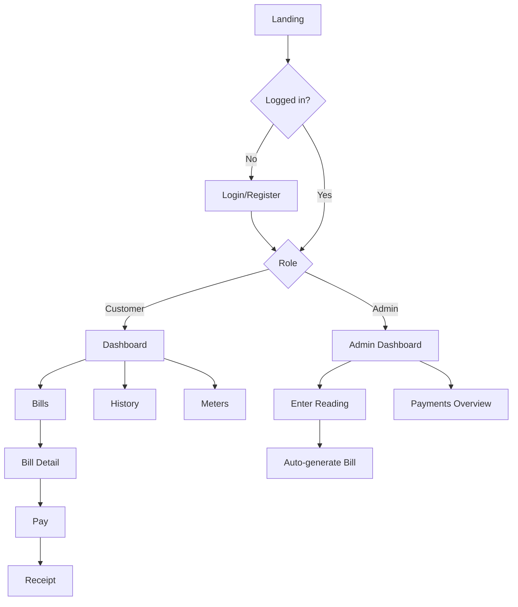

# App Flow

## Customer Flow
1. Landing -> Register / Login
2. Dashboard: outstanding balance, latest bill
3. Meters: add / view meters
4. Bills: list (Unpaid / Paid / Overdue) -> bill detail
5. Pay: choose method -> enter phone -> confirm -> receipt
6. History: filter payments -> view/print receipt

## Admin Flow
1. Login -> Admin dashboard (totals)
2. Enter reading for a meter -> consumption computed
3. Bill auto-generated from reading using tariff
4. Payments overview

## Diagram

## Bill States
`unpaid -> paid`, `unpaid -> overdue` (past due date), `overdue -> paid`
