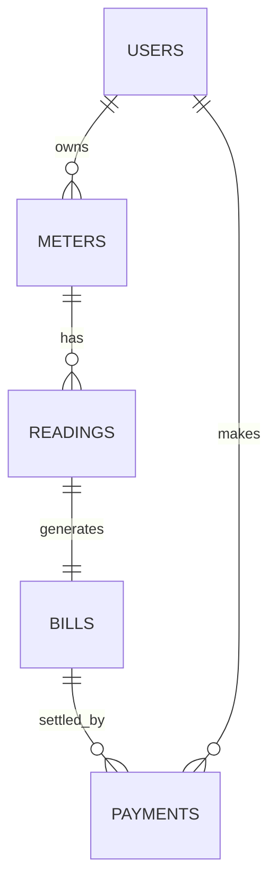

# Backend Schema

## Tables
**users**: id PK, full_name, email UNIQUE, phone, password_hash, role (`customer`/`admin`), created_at

**meters**: id PK, user_id FK, meter_number UNIQUE, location, created_at

**readings**: id PK, meter_id FK, reading_date, previous_value, current_value, consumption (m3), recorded_by FK

**bills**: id PK, reading_id FK UNIQUE, meter_id FK, period (YYYY-MM), consumption, amount_rwf, due_date, status (`unpaid`/`paid`/`overdue`), created_at

**payments**: id PK, bill_id FK, user_id FK, amount_rwf, method (`momo`/`airtel`/`cash`), phone, reference, receipt_no UNIQUE, status (`success`/`failed`/`pending`), paid_at

(Exact SQL is in `server/db.js`.)

## Endpoints
| Method | Path | Role | Purpose |
|--------|------|------|---------|
| POST | /api/auth/register | public | Create customer |
| POST | /api/auth/login | public | Get JWT |
| GET, POST | /api/meters | customer | List / add meters |
| POST | /api/readings | admin | Record reading, auto-create bill |
| GET | /api/bills | both | List bills (own, or all for admin) |
| POST | /api/payments | customer | Pay a bill |
| GET | /api/payments | both | History (filters: status, from, to) |
| GET | /api/stats | admin | Totals |

## Rules
- `current_value >= previous_value`
- A bill can be paid only once; payment amount equals bill amount in v1.
- A bill is overdue when `due_date < today` and it is unpaid.
